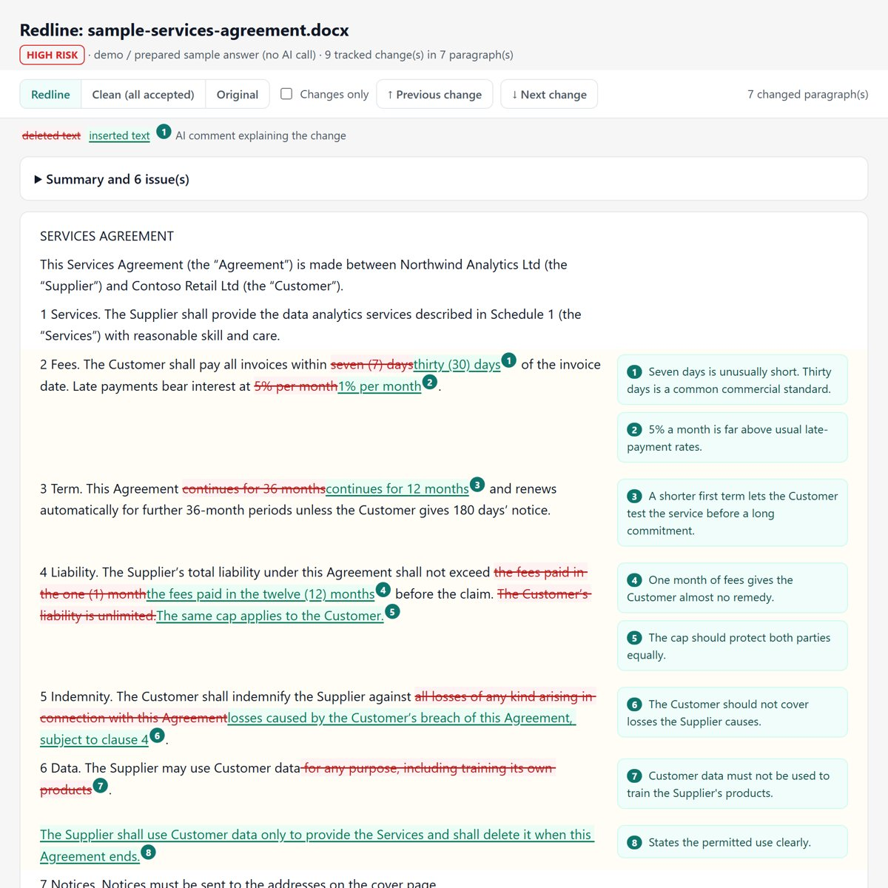

# Open Contract Redline

**Free, open-source AI contract review that gives you a real Word redline.**

Give it a contract. One AI reads it, lists the issues by risk, and **shows you the redline right in your browser**: deletions struck through, insertions underlined, and a comment explaining every change. When you are happy, download your `.docx` with **real Word tracked changes and margin comments**, ready to send back to the other side.



- **No API key needed with Claude Code or Codex:** your AI agent does the review itself (agent mode)
- Or bring your own API key for **Claude, GPT, DeepSeek or Mistral**
- One AI per review, the one you choose. No hidden second model.
- Runs on your own computer. Your contract goes only to the AI you use, and nowhere else.
- Review the redline on screen: switch between **Redline**, **Clean** (all changes accepted) and **Original**, jump from change to change, or show changes only
- No API key yet? Press **Try the demo** to see a full review of the sample contract
- Works as a local web page or from the command line
- Plain JavaScript, small codebase: built to be changed with **Claude Code** or **Codex**

> AI output is a first draft for a qualified lawyer to check. It is not legal advice.

---

## Quickest start: one prompt in Claude Code or Codex (no API key)

Open **Claude Code** or **Codex** and paste:

> Install the free contract redline tool from github.com/AlexaAdmin/open-contract-redline, then use agent mode to redline my contract "My Contract.docx" and open the redline in my browser.

Your AI agent downloads the tool, does the review itself, and opens the redline in your browser, with the Word file saved next to your contract. It runs on the Claude or ChatGPT plan you already use for Claude Code or Codex, so you do not need an API key. No contract handy? Ask it to use the sample contract.

How it works: the agent runs `--prepare`, which writes a brief with the review instructions and the contract; it reviews the contract and saves its answer as JSON; then `--from` turns that answer into the redline. The steps are in [AGENTS.md](AGENTS.md), which Claude Code and Codex read automatically.

## Quick start with an API key (5 minutes)

You need [Node.js 20 or later](https://nodejs.org) and an API key from one provider.

```bash
git clone https://github.com/AlexaAdmin/open-contract-redline.git
cd open-contract-redline
npm install
cp .env.example .env      # then paste your API key into .env
npm start                 # open http://localhost:8787
```

On the page, press **Try the demo (no API key)** to see a finished review of the sample contract straight away.

Or from the command line:

```bash
node bin/cli.js "My Contract.docx" --provider anthropic --party "Customer"
```

You get three files next to the contract:

| File | What it is |
|---|---|
| `My Contract - redline.docx` | Your contract with tracked changes and a comment explaining each change |
| `My Contract - redline.html` | The same redline as a web page: open it in any browser, no Word needed |
| `My Contract - review.md` | Summary, overall risk, and every issue with a recommendation |

Try it first on the fictional contract in `examples/sample-services-agreement.docx`.

## Choosing a provider and model

| Provider | `--provider` | Key in `.env` | Default model |
|---|---|---|---|
| Anthropic (Claude) | `anthropic` | `ANTHROPIC_API_KEY` | `claude-opus-5-5` |
| OpenAI (GPT) | `openai` | `OPENAI_API_KEY` | `gpt-6-astra` |
| DeepSeek | `deepseek` | `DEEPSEEK_API_KEY` | `deepseek-v4-pro` |
| Mistral | `mistral` | `MISTRAL_API_KEY` | `mistral-large-latest` |

Use any other model your key can access with `--model <id>`, or set `ANTHROPIC_MODEL`, `OPENAI_MODEL`, `DEEPSEEK_MODEL` or `MISTRAL_MODEL` in `.env`. Providers rename models from time to time: if a default stops working, check the provider's model list and set the new id.

## Options

| Option | Meaning |
|---|---|
| `--party "Supplier"` | Who you act for. The review protects this party. |
| `--playbook positions.md` | Your firm's positions (liability caps, governing law, red lines). The model follows them where they apply. |
| `--model <id>` | Use a specific model. |
| `--out folder` | Where to save the files. |
| `--open` | Open the browser redline when it is ready. |
| `--prepare` / `--from review.json` | Agent mode: write the brief for an AI agent, then build the redline from its answer. |

The web page has the same options.

## How it works

1. `src/docx.js` reads the Word file into numbered paragraphs (including table cells).
2. `src/providers.js` sends them, with the instructions in `src/prompt.js`, to **one** model and asks for JSON: summary, issues and precise edits.
3. `src/docx.js` writes each edit back as a Word tracked change (deletion + insertion) with a comment. Paragraphs the model did not touch are left exactly as they were, formatting included.
4. `src/preview.js` reads the finished `.docx` back and draws it as a web page, so what you see on screen is exactly what Word will show.
5. If an edit cannot be placed safely (for example, inside a hyperlink or a field), it is not forced into the document. It is listed in the review file so you can apply it by hand.

Supported files: `.docx`, `.txt`, `.md`. For a PDF, save it as Word first.

## Your data

- Nothing is stored by this tool. The local web page listens on `127.0.0.1` only.
- Your contract is sent to the AI you use, under that provider's terms: the API provider you choose, or in agent mode the company behind your AI agent (Anthropic for Claude Code, OpenAI for Codex). Check their data retention and training settings, and use an account your firm has approved for client documents.
- Keep your `.env` file private. It is listed in `.gitignore`.

## Make it yours with Claude Code or Codex

Open the folder in Claude Code or Codex and ask in plain words, for example:

- "Add a clause library: when the model suggests a new clause, use our standard wording from `clauses/`."
- "Add a second pass that checks every cross-reference in the redline."
- "Export the issue list to Excel as well."
- "Make the comments come from 'Jane Smith, Legal' instead of 'AI Review'."
- "Support PDF uploads."

`AGENTS.md` (Codex) and `CLAUDE.md` (Claude Code) tell the coding agent how the project is laid out and how to test a change. Run `npm test` after every change: the tests check the redline without needing an API key.

## Want the full workspace?

This repository does one job: review and redline a single contract. **[ContractApp](https://www.ai2bundle.co/contractapp-enterprise)** is the full AI workspace for law firms and in-house teams, with matters, firm playbooks, team approvals, due diligence, drafting, research and secure firm-wide storage.

## Licence

[Apache License 2.0](LICENSE). You may use, change and share this code, including commercially, as long as you keep the licence and the notices in [NOTICE](NOTICE). The licence does not cover our names or logos.

Contributions are welcome: open an issue or a pull request.
